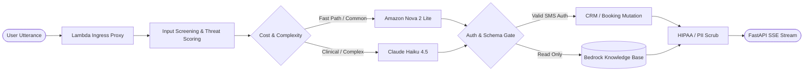

  <strong>English</strong> · <a href="README_KO.md">한국어</a>

# Subin Hong (홍수빈)
### AI Systems & Platform Engineer · LLM Red-Teamer
*Production Agentic Systems · Defense-in-Depth Architecture · Cloud-Native Platforms*

| Dimension | Specification |
|---|---|
| **Primary Focus** | Production Agentic Orchestration on AWS Bedrock · Adversarial Safety · Resilient Serverless Platforms |
| **Engineering Track** | 3 Personal Red-Team Accolades · Primary Engineer for 2 Award-Winning Shipped Platforms |
| **Production Scale** | Autonomous Hospital Agent: 5 Tenants × 12 Languages · 1,152 Commits · 116 Releases (Sole Author) |
| **Location** | Seoul, South Korea |

---

## 📊 Production Scale & Engineering Velocity

| Metric | Footprint | Architectural Significance |
|---|:---:|---|
| **Multi-Tenant Concurrency** | **5 Tenants × 12 Languages** | Strict data isolation via per-tenant KMS & Bedrock KB routing |
| **Full Lifecycle Delivery** | **1,152 Commits · 651 PRs · 116 Releases** | Empty-repo to live serverless production as sole author |
| **Automated Test Oracle** | **1,656 Tests · 96% Coverage** | Contract-driven test oracle; zero DB mutation without auth |
| **Defensive Control Catalog** | **198 Codified Controls** | 128 infra + 70 KISA rules codified into reusable skills |

---

## 🚀 Flagship System: Autonomous Healthcare Agent

> Production conversational AI agent serving 5 hospital networks across 12 languages with end-to-end multi-turn tool execution.

- **Two-Stage Model Routing:** Low-latency common queries route through Amazon Nova 2 Lite; complex clinical escalations pass to Claude Haiku 4.5, optimizing token cost and latency.
- **Fail-Closed Retrieval:** Knowledge Base candidate retrieval oversamples 20 chunks; reranker drops scores < 0.5 directly to deterministic fallback, preventing medical hallucinations.
- **Strict State Separation:** The LLM executes utterance analysis and sentence generation only; state persistence and CRM mutations require valid SMS auth tokens.

<b>🔍 View 20-Layer Defense-in-Depth Specification (Click to expand)</b>

 

| Tier | Layer Range | Defense Mechanism & Implementation |
|---|---|---|
| **Ingress & AST** | Layers 1–5 | Non-printable Unicode normalization, prompt injection pattern matching, and input length bounding. |
| **Semantic & Intent** | Layers 6–10 | Jailbreak heuristic evaluation, dynamic threat scoring, and enforce-vs-notify policy split. |
| **Execution Sandbox** | Layers 11–15 | Pre-warmed ARM64 container runtime isolation, read-only AST checkers, and SMS authentication gates. |
| **Egress & Audit** | Layers 16–20 | PII scrubbing, HIPAA compliance filter, and Datadog LLMObs distributed tracing. |

---

## ⚡ Zero-to-Production Deliveries

The same empty-repo-to-live-serverless motion, repeated across high-assurance services.

| System | Scale & Rigor | Architectural Core |
|---|---|---|
| **Stateless NLU+NLG Reservation Agent** | 162 commits · 82 PRs · 1,656 tests (96% coverage) | 17-mode typed contract serves as test oracle; rule-based deterministic date/time resolution; zero DB writes. |
| **Knowledge Base Admin Backend** | 116 commits · 68 PRs · E2E verified | Bedrock KB administrative control plane on FastAPI / Lambda + CloudFront with Terraform IaC. |
| **Speech-to-Speech Voice Demo** | 68 commits · Real-time pipeline | Low-latency voice agent: OpenAI Realtime → Bedrock Nova Sonic pipeline in serverless environment. |

---

## 🛡️ Defensive Engineering & AX Enablement

- **Read-Only Security Framework:** Codified 198 controls (128 infrastructure + 70 KISA application checks) into shareable Claude Code skills with AST-level gates blocking credential minting.
- **Engineering Governance:** Triaged 50+ repositories into an Active 10 / Archived 42 lifecycle split with automated Dependabot CI and commit-SHA action pinning.
- **Developer Enablement (git-quest):** Built a 13-mission git onboarding RPG workshop with an AI code-review gate on Amazon Nova 2 Lite.

---

## 🛠️ Core Competencies & Stack

| Domain | Technologies & Infrastructure |
|---|---|
| **Agentic AI & Orchestration** |      |
| **Cloud & Platform** |     |
| **Security & Observability** |     |

---

## 🏆 Honors & Recognition

### Adversarial AI & Red-Teaming (Personal)
| Credential | Result | Evidence |
|---|---|---|
| **SFASS 2026 AI Red-Teaming Workshop** (2026-07-08) | 5th of on-site Top 7 | ETRI-issued certificate · [Coverage](https://www.newsis.com/view/NISX20260708_0003701530) |
| **AIM Intelligence AI Red-Team Arena 2026** (Apr–Jun 2026) | #33 on global leaderboard (709.00 pts / 91 breaches) | [Leaderboard](https://judgementday.aim-intelligence.com/leaderboard) |
| **Korea MFDS AI Medical-Device Red-Team Challenge** (Sep 2025) | Grand Prize (최우수상) | [Announcement](https://talkcrm24.com/blog?tpf=board/view&board_code=54&code=221) |

### Shipped AI Products (Primary Engineer)
| Product & Honor | Role | Evidence |
|---|---|---|
| **CES 2026 Innovation Award (Artificial Intelligence)** | Primary engineer of production AI agent | [CES Honoree](https://www.ces.tech/ces-innovation-awards/2026/talkcrm-ai-intelligent-care-communication-platform/) · [Announcement](https://talkcrm24.com/blog?tpf=board/view&board_code=54&code=267) |
| **KSA Service AI Leader Award 2026 (Korea Standards Assoc.)** | Responsible engineer; authored submission | [Announcement](https://talkcrm24.com/blog?tpf=board/view&board_code=54&code=328) |

---

## 📈 Activity

<!-- profile-metrics:start -->
- Last updated: 2026-09-06
- 8,683 contributions in the last 12 months
- 23 pull request contributions and 199 commit contributions across 13 repositories
- 22 owned public repositories and 79 owned private repositories (excluding forks)
- Private and internal work represent most of the recent contribution volume
<!-- profile-metrics:end -->

---

  Open to technical discussions, architecture walkthroughs, and security research collaboration via GitHub.

