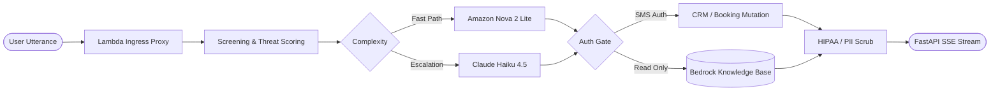

<div align="right">
  <strong>English</strong> · <a href="README_KO.md">한국어</a>
</div>

# Subin Hong (홍수빈)
**AI Systems Engineer & LLM Red-Teamer** · *Production Agentic Systems and Adversarial Safety*

[](https://www.ces.tech/ces-innovation-awards/2026/talkcrm-ai-intelligent-care-communication-platform/)
[](https://talkcrm24.com/blog?tpf=board/view&board_code=54&code=328)
[](https://judgementday.aim-intelligence.com/leaderboard)
[](https://www.newsis.com/view/NISX20260708_0003701530)
[](https://talkcrm24.com/blog?tpf=board/view&board_code=54&code=221)

| Production Footprint | Full-Lifecycle Velocity | Testing & Verification | Defensive Automation |
|:---:|:---:|:---:|:---:|
| **5 Hospitals × 12 Languages**<br><sub>Nova 2 Lite + Haiku 4.5 routing</sub> | **1,152 Commits · 116 Releases**<br><sub>Sole author from empty repo to production</sub> | **1,656 Tests · 96% Coverage**<br><sub>Typed contract oracle · SMS auth</sub> | **198 Codified Controls**<br><sub>128 infra + 70 KISA guardrails</sub> |

```
• Core AI & Cloud: Python 3.11+ · AWS Bedrock (AgentCore) · Claude Haiku 4.5 · Nova 2 Lite · FastAPI · Lambda · PostgreSQL · Terraform
• Security & Ops:  Datadog LLMObs · AST Read-Only Screening · TruffleHog CI · GitHub Actions · OpenSSF Scorecard
```

### 🏆 Verified Honors
- **CES 2026 Innovation Honoree** & **KSA Service AI Leader 2026**: Responsible engineer and submission author for award-winning production AI agent ([CES Honoree](https://www.ces.tech/ces-innovation-awards/2026/talkcrm-ai-intelligent-care-communication-platform/) · [KSA Announcement](https://talkcrm24.com/blog?tpf=board/view&board_code=54&code=328))
- **AIM Arena 2026**: #33 on global leaderboard with 709.00 points and 91 confirmed breaches ([Leaderboard](https://judgementday.aim-intelligence.com/leaderboard))
- **SFASS 2026**: 5th of on-site Top 7 ([Coverage](https://www.newsis.com/view/NISX20260708_0003701530)) · **Korea MFDS Challenge 2025**: Grand Prize ([Announcement](https://talkcrm24.com/blog?tpf=board/view&board_code=54&code=221))

<details>
<summary><b>🔍 Architecture Deep Dive & 20-Layer Defense Matrix (Click to expand)</b></summary>

<br>

#### Flagship: Healthcare AI Agent Architecture


- **Two-Stage Model Routing:** Fast queries route to Nova 2 Lite; clinical questions escalate to Claude Haiku 4.5.
- **Fail-Closed Retrieval:** The system pulls 20 chunks from the KB and reranks them in Seoul. Scores under 0.5 fall back to standard guidance to prevent medical hallucinations.
- **Zero-to-Production Deliveries:** Stateless reservation agent (17 typed contract modes, 1,656 tests, 96% coverage) · Bedrock KB admin backend on FastAPI, Lambda, and Terraform · Real-time voice agent with OpenAI Realtime and Bedrock Nova Sonic.

| Tier | Layers | Defense Mechanism & Implementation |
|---|---|---|
| **Ingress & AST** | L1-L5 | Unicode normalization, prompt injection screening, strict input bounding |
| **Semantic & Intent** | L6-L10 | Jailbreak heuristics, dynamic threat scoring, enforce-vs-notify policy split |
| **Execution Sandbox** | L11-L15 | Pre-warmed ARM64 container isolation, read-only AST checkers, SMS auth gates |
| **Egress & Audit** | L16-L20 | PII scrubbing, HIPAA compliance filter, Datadog LLMObs distributed tracing |

#### Activity
<!-- profile-metrics:start -->
- Last updated: 2026-09-06
- 8,688 contributions in the last 12 months
- 23 pull request contributions and 204 commit contributions across 13 repositories
- 22 owned public repositories and 79 owned private repositories (excluding forks)
- Private and internal work represent most of the recent contribution volume
<!-- profile-metrics:end -->

</details>
